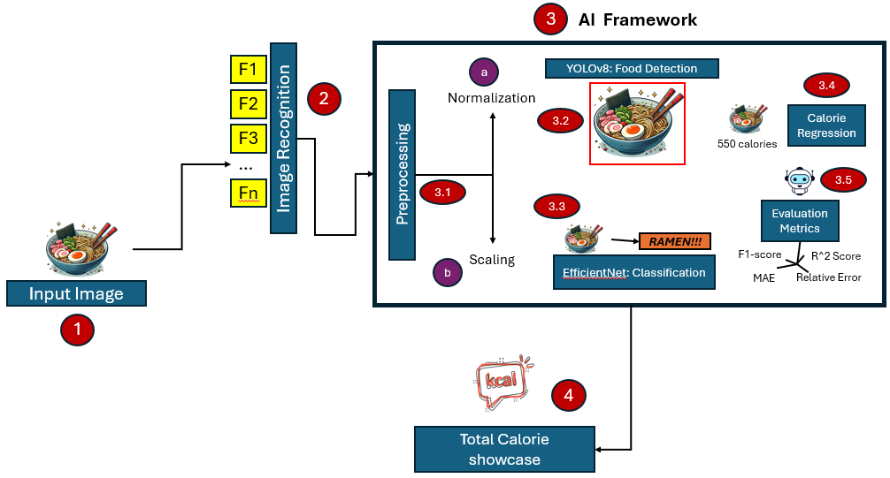
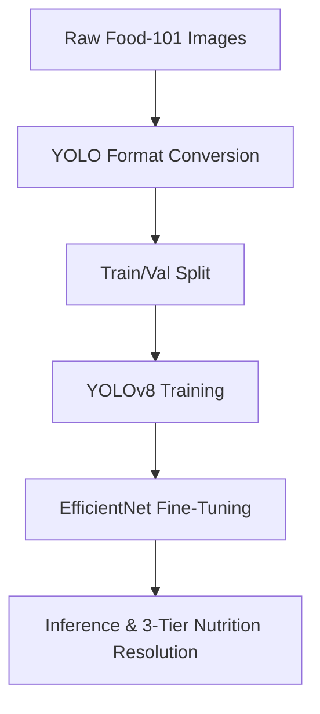
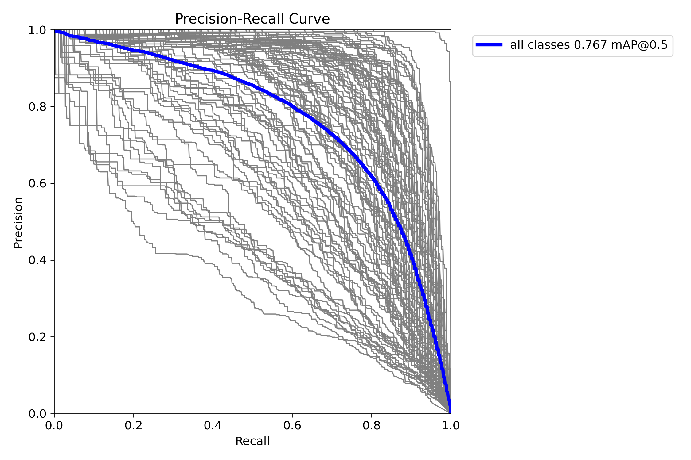

# Food Recognition and Calorie Estimation System

Deep learning pipeline for detecting food items in images, classifying them into 101 categories, and estimating their nutritional values (calories, protein, etc.) using YOLOv8, EfficientNet, and the USDA FoodData API.



---

## Table of Contents
- [Key Features](#key-features)
- [Technical Specifications](#technical-specifications)
- [System Architecture & Data Flow](#system-architecture--data-flow)
- [Dataset](#dataset)
- [Project Structure](#project-structure)
- [Methodology](#methodology)
- [Backend Infrastructure](#backend-infrastructure)
- - [PostgreSQL Database Layer](#postgresql-database-layer)
- - [Redis In-Memory Caching](#redis-in-memory-caching)
- - [Automated Testing with Pytest](#automated-testing-with-pytest)
- [Results](#results)
- [Installation & Setup](#installation)
- [Usage](#usage)
- [API Integration & 3-Tier Caching](#api-integration)
- [Limitations](#limitations)
- [Future Work](#future-work)
- [References](#references)
- [Author](#author)

---

## Key Features

### 1. Multi-Food Detection
- YOLOv8-based object detection (76.7% mAP@0.5)
- Handles up to 10 food items per image
- Robust to occlusions (≤8% mAP drop)

### 2. Fine-Grained Classification
- EfficientNet-B3 classifier (82.3% accuracy)
- 101 food categories from Food-101 dataset
- Cultural bias analysis (12.6% accuracy gap identified)

### 3. Nutritional Analysis & High-Performance Caching
- USDA API integration for calorie, protein, fat, and carbohydrate lookup
- 3-tier caching system (Redis → PostgreSQL → USDA API) for sub-millisecond nutritional lookups
- Automatic TTL refresh on cache hits to ensure fast access for popular foods
- 48.2 kcal mean absolute error (MAE)
- Supports 72% of Food-101 classes

### 4. Enterprise Infrastructure & Quality Assurance
- Relational schema for long-term prediction logs and nutritional persistence
- Unit and integration testing suite powered by Pytest
- Automated YOLO dataset conversion
- ImageNet transfer learning (19.5% accuracy boost)
- Mobile-optimized architecture (desktop-tested)

---

## Technical Specifications

| Component        | Specification                        |
|------------------|--------------------------------------|
| Detection Model  | YOLOv8n (416x416 input)              |
| Classification   | EfficientNet-B3 (ImageNet weights)   |
| Database Layer   | PostgreSQL 15+                       |
| In-Memory Cache  | Redis 7+ (24h TTL with auto-renewal) | 
| Test Framework   | Pytest 7+ (pytest-mock)              | 
| Training Epochs  | 10                                   |
| Batch Size       | 32                                   |
| Learning Rate    | 0.01 (cosine decay)                  |
| Key Metrics      | mAP@0.5: 76.7%, MAE: 48.2 kcal       |

---

## System Architecture & Data Flow

[ Input Image ] ---> [ YOLOv8 Detection ] ---> [ EfficientNet Classification ]
                                                          |
                                                          v
                                              [ Recognized Food Name ]
                                                          |
                                                          v
                                             +-------------------------+
                                             | 3-Tier Caching Hierarchy|
                                             +-------------------------+
                                                          |
                 +----------------------------------------+----------------------------------------+
                 | (Tier 1: Hit)                          | (Tier 2: Miss -> PG Hit)               | (Tier 3: Miss -> API Hit)
                 v                                        v                                        v
          [ Redis Memory ]                        [ PostgreSQL DB ]                       [ USDA FoodData API ]
       (Sub-ms response + TTL                     (Persisted lookup,                      (Fetches fresh macros,
            Renewal)                               backfills Redis)                     saves to PG & Redis)

---

## Dataset
**Food-101 Dataset** (Bossard et al., 2014)
- 101,000 images across 101 food categories
- 750 training + 250 test images per class
- Manually verified labels (>90% accuracy)
- [Dataset Link](https://data.vision.ee.ethz.ch/cvl/datasets_extra/food-101/)

**Additional Components:**
- Custom YOLO format conversion
- USDA nutritional database integration
- UECFOOD100 for bias validation

---

## Project Structure
```
food-recognition/
├── data/                       # Original Food-101 dataset
│   ├── images/                 # Raw image files divided by class
│   └── meta/                   # Class labels, train/test split metadata
├── yolo_dataset/               # Converted YOLO format dataset
│   ├── labels/
│   │   ├── train/              # Annotation text files for model training
│   │   └── val/                # Annotation text files for validation
│   ├── train.cache             # Dataset training cache file
│   └── val.cache               # Dataset validation cache file
├── runs/detect/                # YOLO training iterations, validation outputs, and logs
├── Figures/                    # Evaluation plots, confusion matrices, and diagrams
├── tests/                      # Automated test suite
│   ├── test_pipeline.py        # CV preprocessing and model logic tests
│   └── test_cache.py           # 3-tier caching and fallback logic tests
├── config.py                   # Centralized system configurations and environment variables
├── db.py                       # PostgreSQL initialization, schema, and queries
├── usda_client.py              # External USDA FoodData Central REST API client
├── cache.py                    # 3-Tier lookup orchestrator (Redis -> Postgres -> USDA API)
├── Model_training.ipynb        # Jupyter notebook: EDA, YOLO conversion, model training & API mapping
├── Model_training_command.py   # CLI script for model training execution
├── nutrition_data.json         # Offline static USDA nutritional fallback mappings
├── yolo11/8n.pt                # Trained YOLO weights model file
└── README.md                   # System documentation
```

---

## Methodology

### 1. Data Pipeline


### 2. Model Architecture
- Detection: YOLOv8n with custom anchor parameters optimized for multi-food scenes.
- Classification: EfficientNet-B3 with modified classification head tuned for 101 food classes.
- Nutritional Resolution: 3-tier fallback lookup system (Redis → PostgreSQL → USDA REST API).

### 3. Key Algorithms
- Cosine learning rate scheduling
- Random flip/rotation data augmentations
- Class-balanced sampling
- TTL Cache-Aside strategy with read-time TTL extension

---

## Backend Infrastructure

### PostgreSQL Database Layer

Acts as the permanent relational source of truth. It prevents unnecessary repeated external API calls and keeps a permanent record of all model inferences.
- food_nutrition Table: Stores clean food names alongside calories, protein, fat, and carbohydrate values.
- inference_logs Table: Records image paths, predicted food classes, confidence scores, and timestamps for analytics.

### Redis In-Memory Caching

Acts as the primary ultra-low latency caching layer operating entirely in RAM.

- Key Schema: nutrition:{food_name}
- Cache-Aside Strategy: Serves queries in <2ms.
- TTL Renewal: On a Redis hit, the 24-hour expiration clock (86,400s) resets, keeping frequently queried foods cached indefinitely.

### Automated Testing with Pytest

Located in the tests/ directory to prevent regressions and enforce modularity:
- test_pipeline.py: Validates image preprocessing tensor shapes (e.g., resizing to 416x416), normalization scaling, and handling of malformed input arrays.
- test_cache.py: Tests unit behaviors across all 3 tiers (Redis hit, PostgreSQL hit, and USDA API fallback) using mocks (pytest-mock) to run fast offline tests without network calls.

---

## Results

```bash
| Metric                | Value        |
|-----------------------|--------------|
| mAP@0.5               | 76.7%        |
| Classification Acc.   | 82.3%        |
| Calorie MAE           | 48.2 kcal    |
| Western-Asian Gap     | 12.6%        |

```

*Precision-Recall performance across 101 classes*

---

## Installation & Setup

1. Clone repository:
```bash
git clone https://github.com/yourusername/food-recognition.git
cd food-recognition
```

2. Install dependencies:
```bash
pip install -r requirements.txt
```

3. Start PostgreSQL & Redis Infrastructure (via Docker):
```bash
# Run Redis container
docker run -d -p 6379:6379 --name food-redis redis:latest

# Run PostgreSQL container
docker run -d -p 5432:5432 --name food-postgres -e POSTGRES_PASSWORD=yourpassword -e POSTGRES_DB=food_db postgres:latest
```

4. Initialize Database Tables:
```bash
python db.py
```

5. Download datasets:
```bash
!kaggle datasets download -d kmader/food41 -p data --unzip
```

---

## Usage

### Training
Execute model training via script or directly through Model_training.ipynb:
```bash
python train.py --data food101.yaml --epochs 10 --imgsz 416
```

### Running Automated Test Suite
Ensure pipeline integrity and caching logic via Pytest:
```bash
# Run all unit and integration tests
pytest -v
```

### Inference
```bash
python detect.py --source test_image.jpg --weights models/yolov8n.pt
```

### Nutritional Analysis
```bash
from cache import get_food_nutrition_optimized

# Resolves nutritional metrics through Redis -> Postgres -> USDA API
nutrition = get_food_nutrition_optimized("hamburger")
print(nutrition)
# Output: {'food_name': 'hamburger', 'calories': 250.0, 'protein': 12.0, 'fat': 14.0, 'carbs': 20.0}
```

---

## API Integration & 3-Tier Caching 

The 3-tier lookup mechanism ensures minimum latency and protects external API quotas:
```bash
# Function signature from cache.py
def get_food_nutrition_optimized(food_name: str, cache_ttl: int = 86400) -> dict:
    """
    1. Tier 1 (Redis): In-Memory lookup (<2ms). Resets TTL timer on hit.
    2. Tier 2 (PostgreSQL): Local DB lookup (~10ms). Populates Redis on hit.
    3. Tier 3 (USDA API): External API lookup (~500ms). Persists to Postgres and Redis on hit.
    """
```

---

## Limitations

1. Portion size estimation not implemented
2. Mobile deployment pending validation
3. 28% of classes lack USDA nutritional data
4. Cultural bias in Western-centric training data

---

## Future Work

- Integrate depth estimation (e.g., MiDaS) for volume and portion estimation.
- Develop a React Native / Flutter mobile client interface.
- Implement FastAPI REST endpoints wrapping cache.py and YOLO models.
- Expand classification capabilities to 500+ food categories.

---

## References

- Bossard, L. et al. (2014). "Food-101". ECCV.
- Ultralytics (2023). "YOLOv8 Documentation".
- Tan, M. & Le, Q.V. (2019). "EfficientNet". ICML.

---

## Author
Dennis Alejandro Guerra Calix
University of Europe for Applied Sciences
Potsdam, Germany
dennisalejandro.guerracalix@ue-germany.de